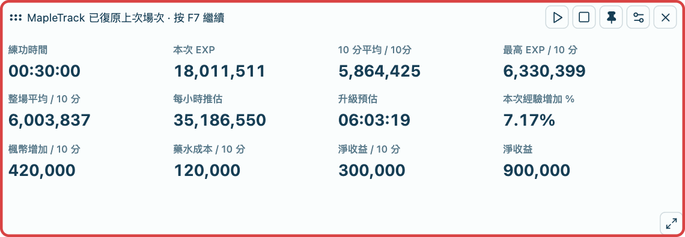
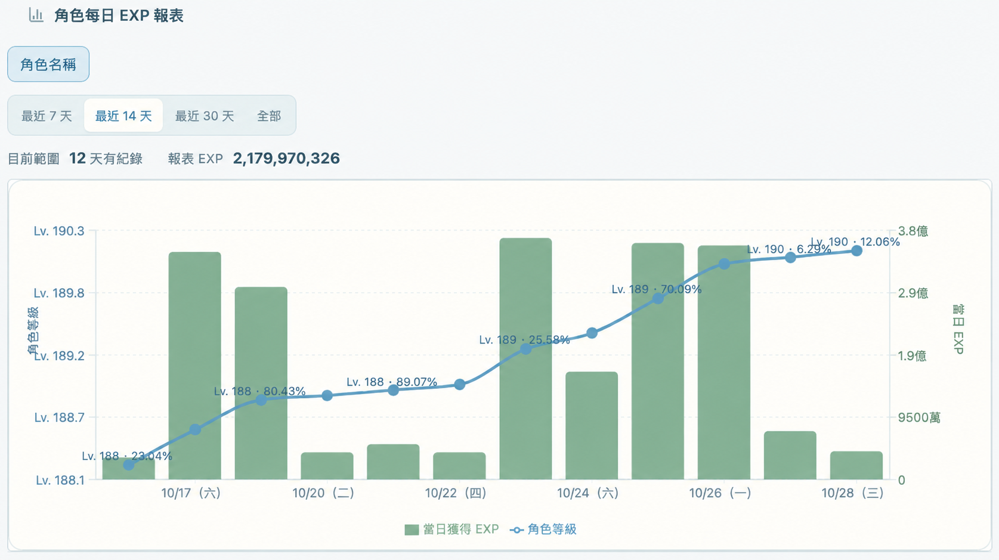
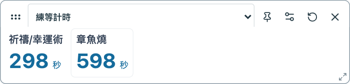
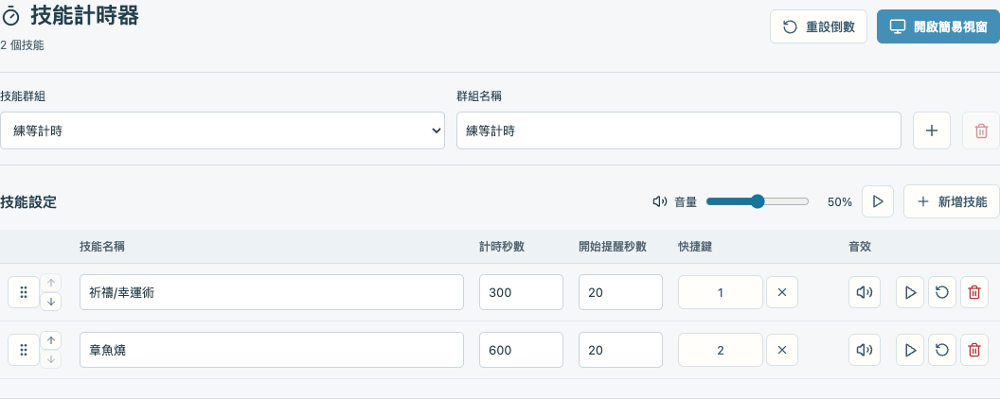
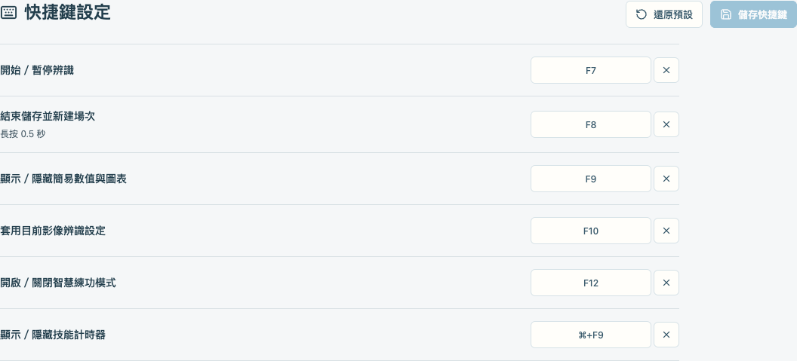

# MapleTrack

MapleTrack 是專為 **MapleStory Worlds／Artale** 設計的練功效率追蹤工具。  
透過畫面辨識讀取 EXP、楓幣與 HP／MP 藥水剩餘數量，協助你查看即時效率、升級進度、藥水成本與每日練功紀錄。  
另提供技能倒數計時與音效提醒，支援獨立簡易視窗及自訂快捷鍵。

## 下載最新版

### MapleTrack v2.5.0
- [下載 Windows 版本](https://mapletrack-download.chiu8263.workers.dev/windows)
- [下載 macOS 版本](https://mapletrack-download.chiu8263.workers.dev/mac)

點擊這裡展開更新紀錄內容

### v2.5.0 更新項目-2026/10/23

- **新增技能計時器**：支援多組技能配置，可自訂技能名稱、倒數秒數、提醒秒數與技能快捷鍵。
- **新增簡易計時視窗**：可切換技能群組，調整技能順序、文字大小、顏色、底色與透明度；連點技能兩下即可開始或重新倒數。
- **分階段提醒與音效**：接近時間時分三階段提示，每階段播放一聲提醒，支援音效開關、音量調整及試聽。
- **新增快捷鍵設定頁面**：集中查看與自訂辨識控制、簡易數值與圖表、智慧練功模式及技能計時器的快捷鍵。

### v2.4.1 更新項目-2026/10/3
- 介面排版優化：調整狀態總覽的資訊層級與間距，讓重要數據更容易掃讀。
- 效能優化：重用遊戲視窗擷取設定，避免每輪重新查詢完整視窗清單，降低監控對遊戲流暢度的影響。

### v2.4.0 更新內容-2026/9/30
- 新增智慧練功模式：EXP 增加時自動開始，閒置後自動暫停，支援 F12 切換。
- 新增練功成果分享，可選擇分享項目並記住設定。
- 優化 EXP、楓幣與 HP／MP 辨識，加入漏位與異常跳值防護。
- 完善藥水成本、楓幣收入與淨收益統計，支援 10 分鐘及每小時推估。
- 優化簡易視窗效能，每秒更新數據，圖表上下限每 30 秒重算。
- 強化測試模式，記錄硬體佔用、辨識失敗率及失敗影像。

### v2.3.0 更新項目-2026/9/27

- **新增藥水用量與成本統計**：框選 HP／MP 藥水剩餘數量並設定單價，查看本次用量、成本、每 10 分鐘及每小時推估。
- **F8 防誤觸**：改為長按 0.5 秒才結束儲存，結束時間與數值以按下 F8 的瞬間為準。

### v2.2.1 更新項目-2026/9/23

- **Windows 10 擷取相容性**：缺少無邊框擷取元件時，改用一般視窗擷取。
- **版本檢查**：改從 GitHub 讀取最新版本，修正更新後仍顯示舊版本的問題。
- **簡易視窗圖釘**：簡易數值與簡易圖表可各自固定上方工具列，重新開啟後會保留設定。
- **工具列外觀**：固定時維持視窗圓角並沿用視窗底色與透明度；未固定時，滑出的工具列使用不透明白底，方便閱讀。

## 程式特色

### 簡易數值視窗

獨立置頂顯示練功時間、EXP 效率、升級預估與淨收益，不必一直切回主畫面。可自行選擇顯示項目、拖曳排序，並調整文字、顏色、透明度與視窗大小。

### 每日角色報表

- **每日 EXP 與等級進度一起看**：長條顯示當日獲得 EXP，折線顯示角色等級與經驗百分比，方便比較每天的練功成果。
- **角色分開查看**：切換角色即可查看各自的成長紀錄，不混在一起。

### 技能計時器｜按鍵啟動，時間到前提醒

- **群組分開設定**：每組可新增多個技能，各自設定名稱、倒數秒數、提醒秒數與快捷鍵。
- **獨立簡易視窗**：從上方工具列切換群組，技能名稱與倒數並排顯示；使用快捷鍵即可開始倒數。
- **提醒清楚、不干擾**：接近時間時分三階段提示，可調整音量、關閉個別技能音效，並直接試聽。

**簡易計時視窗**

**技能群組與提醒設定**

### 自訂快捷鍵｜常用操作集中設定

開始／暫停、結束儲存、顯示簡易視窗、套用影像辨識設定、切換智慧練功模式與技能計時器，都能在同一頁查看及修改快捷鍵。

## 首次使用

1. 開啟 MapleStory Worlds／Artale 與 MapleTrack。
2. 跟著新手引導連接遊戲視窗。
3. 進入「辨識設定」，建立角色與遊戲視窗設定。
4. 點選「圈選辨識範圍」，依範例圈選 EXP、楓幣及需要統計的 HP／MP 藥水剩餘數量。
5. 按下「測試辨識結果」，確認顯示數字與遊戲一致，再按「儲存圈選範圍」。
6. 若要計算藥水成本，在「藥水單價設定」輸入 HP／MP 藥水的每個單價。
7. 回到狀態總覽，按下「開始」或預設快捷鍵 `F7` 開始記錄。
8. 練功結束後長按 `F8` 0.5 秒，儲存目前場次並建立新場次。

以上按鍵為預設值；若已自訂快捷鍵，請使用「快捷鍵設定」中的對應按鍵。

## 技能計時器使用方式

1. 進入「技能計時器」，選擇或新增技能群組。
2. 新增技能，分別輸入名稱、計時秒數與開始提醒秒數；提醒秒數不可大於計時秒數。
3. 點選技能的快捷鍵欄位，按下要使用的按鍵，再設定音效開關及音量；可按試聽按鈕確認大小聲。
4. 開啟簡易計時視窗，在上方工具列選擇群組。
5. 按下技能快捷鍵，或在簡易視窗連點技能兩下或是按下快捷鍵，即可開始或重新倒數。
6. 點選簡易視窗上方的齒輪，調整文字、顏色、透明度與視窗外觀；技能順序可在主畫面的技能設定中調整。

首次使用會提供「練等計時」範例：祈禱／幸運術 300 秒、章魚燒 600 秒，皆於剩餘 20 秒開始提醒，對應技能鍵為 `1`／`2`。請依實際需求修改。
正常建議技能放在 F1.F2.F3等等，避免平常打字的時候重置倒數計時

簡易計時視窗必須保持開啟，才會監聽技能按鍵。關閉後會停止所有倒數與後續音效，重新開啟不會接續舊倒數。

## 快捷鍵

以下為預設快捷鍵，可至「快捷鍵設定」修改，變更後按「儲存快捷鍵」。

| 按鍵 | 功能 |
| --- | --- |
| `F7` | 開始／暫停，再按一次繼續 |
| `F8`（長按 0.5 秒） | 結束並儲存，接著建立新場次 |
| `F9` | 顯示／隱藏簡易數值與簡易圖表 |
| `F10` | 套用目前影像辨識設定的遊戲大小、位置與辨識範圍 |
| Windows：`F11`／macOS：`F12` | 開啟／關閉智慧練功模式 |
| Windows：`Ctrl＋F9`／macOS：`⌘＋F9` | 顯示／隱藏技能計時器 |

## 安裝與更新

### Windows

下載 Windows 安裝檔後，依照安裝程式指示完成安裝。第一次安裝請保持網路連線。

### macOS

1. 下載並解壓縮 macOS 版本。
2. 將 MapleTrack 放入「應用程式」資料夾。
3. 第一次開啟時，依提示允許「螢幕錄製」權限。
4. 若要自動套用遊戲視窗位置與大小，還需要允許「輔助使用」權限。
5. 使用技能快捷鍵時，依提示允許「輸入監控」權限。
6. 授權後請完全關閉 MapleTrack，再重新開啟。

當有新版程式程式安裝時，windows 使用者 不要選擇刪除數據資料，原有辨識設定與練功紀錄即可保留。

## 使用提醒

- 更改遊戲視窗大小、解析度或介面位置後，請重新測試辨識結果。
- 換到另一台電腦時，需要重新設定遊戲視窗與辨識範圍。
- 楓幣統計包含撿取、交易與消費，代表餘額淨變化，不是純打怪收入。
- 經驗效率與升級時間皆為推估值，請以遊戲內實際數值為準。
- 畫面辨識可能受到特效、讀取畫面、介面遮擋及解析度影響。
